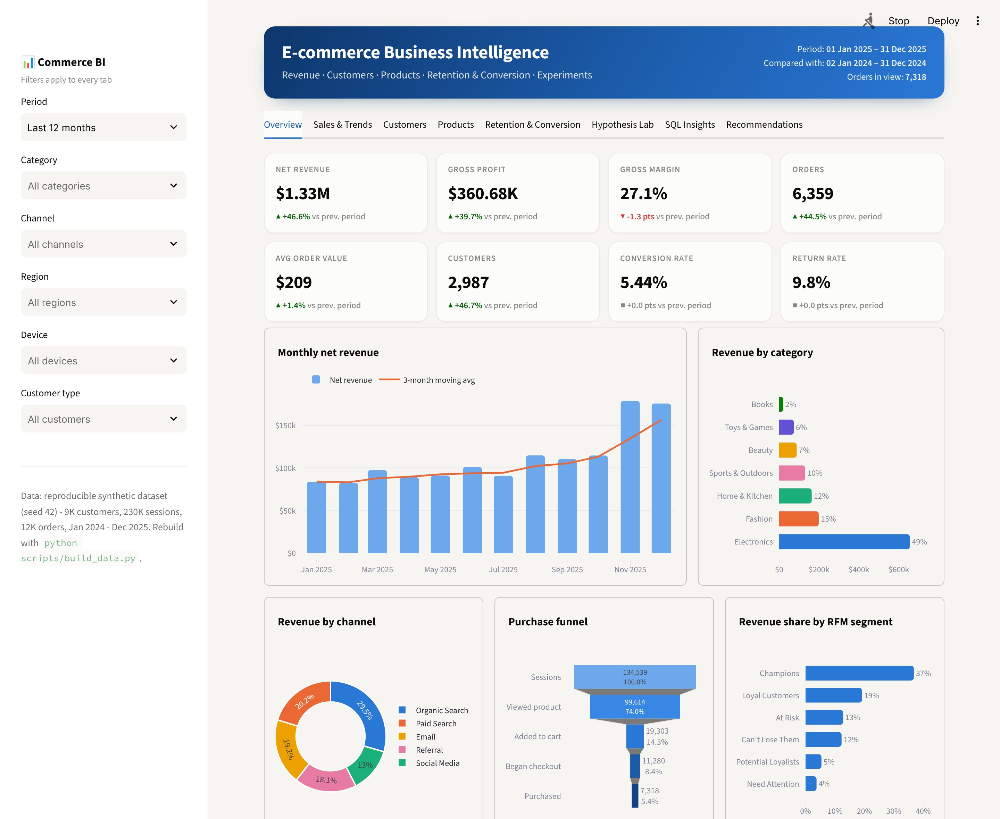
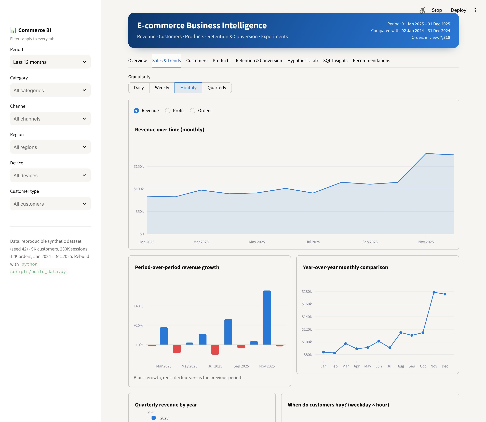
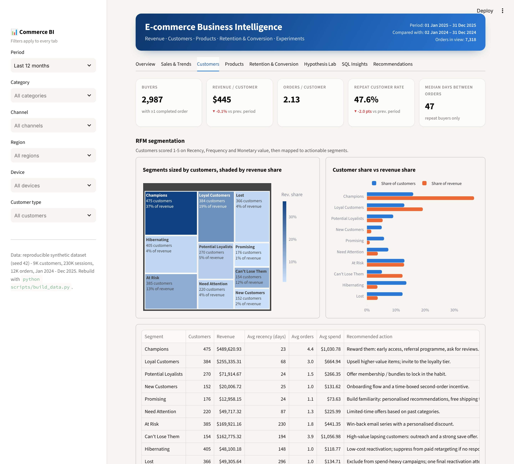
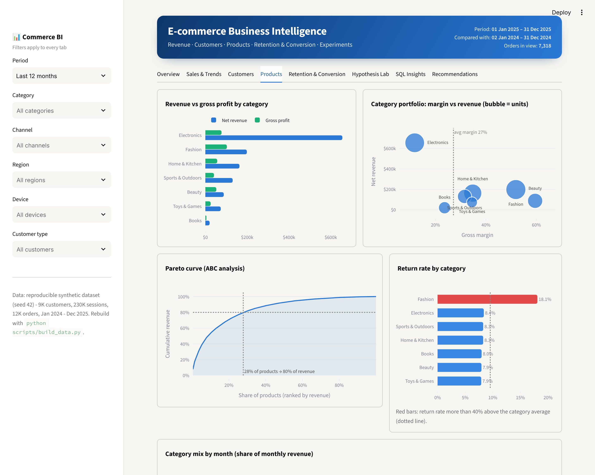
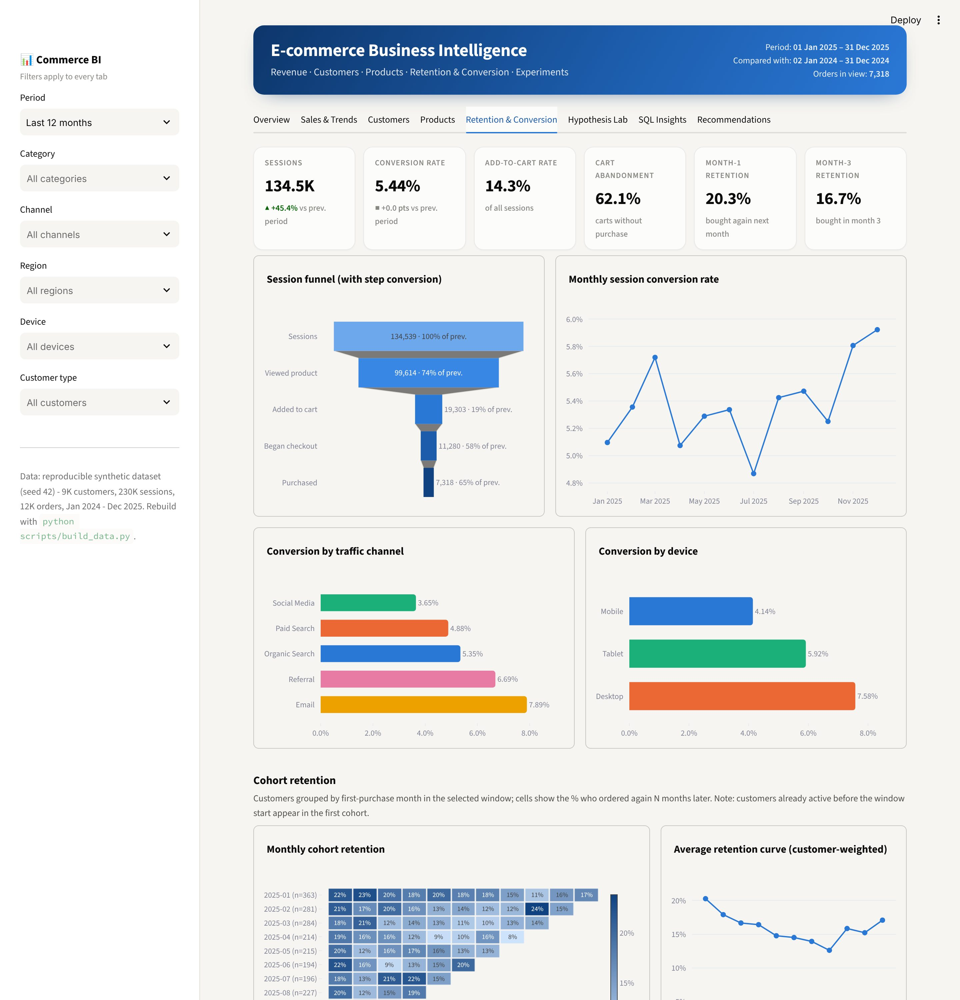
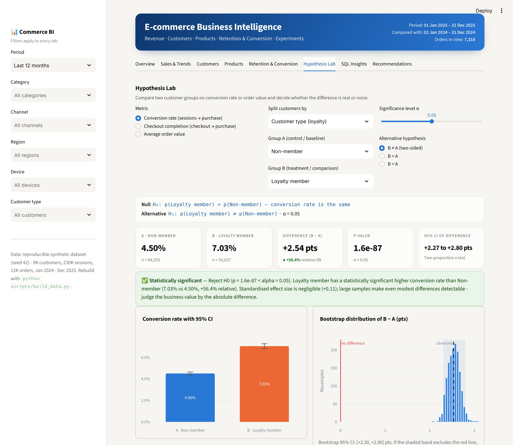
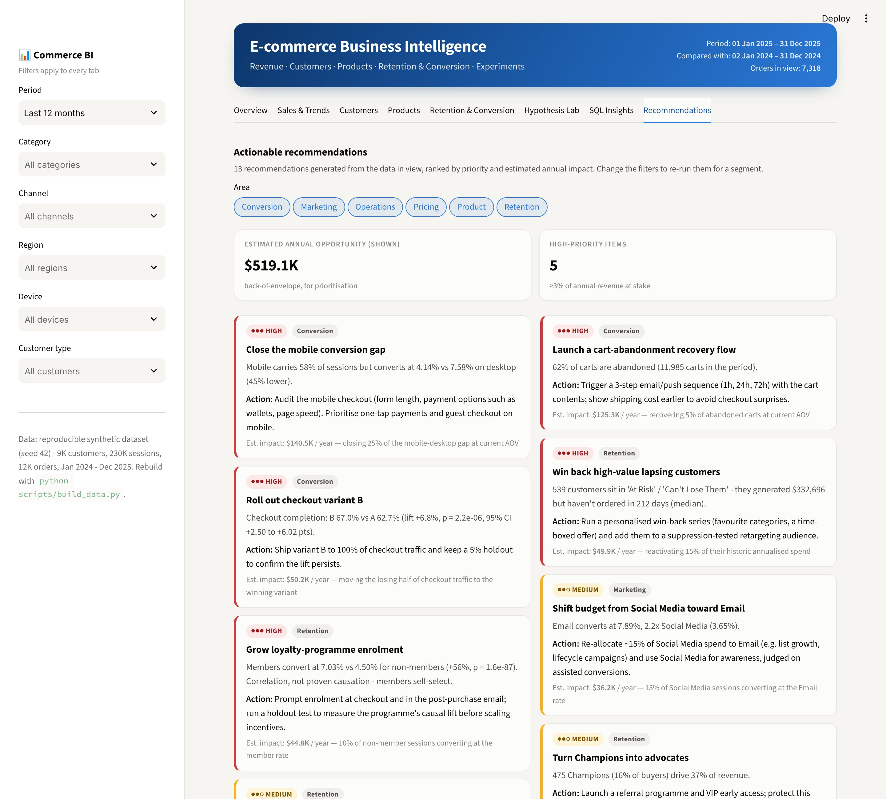

# 📊 E-commerce Business Intelligence Dashboard

An end-to-end BI project built with **SQL + Python**. It covers a star-schema warehouse, 14 business-insight SQL queries,
a pandas analytics layer, an interactive Streamlit + Plotly dashboard, a hypothesis-testing lab and a
recommendation engine that works from the data. There are also **Power BI / Tableau** extracts and a build guide.



## Features

| Requirement | Where |
|---|---|
| Revenue & sales performance | **Overview** tab: 8 KPI cards with period-over-period deltas, monthly revenue + 3-month MA, channel mix, funnel |
| Customer segmentation | **Customers** tab: RFM scoring (quintiles → 10 named segments with recommended actions), breakdowns by channel / region / age / gender / device / loyalty |
| Product & category performance | **Products** tab: revenue vs profit, margin-vs-revenue portfolio, Pareto / ABC analysis, return rates, category-mix heatmap, sortable leaderboard |
| Monthly & quarterly trends | **Sales & Trends** tab: daily/weekly/monthly/quarterly toggle, MoM growth, YoY monthly overlay, quarterly YoY, weekday × hour heatmap |
| Retention & conversion | **Retention & Conversion** tab: session funnel with step conversion, conversion by channel/device, monthly conversion trend, cohort retention matrix, retention curve |
| SQL for business insights | `sql/queries/*.sql` (14 queries: CTEs, window functions, NTILE RFM, cohorts, Pareto). They run live in the **SQL Insights** tab, which also has a read-only ad-hoc SQL editor |
| Interactive dashboard + recommendations | Sidebar filters (period, category, channel, region, device, customer type) drive every tab. The **Recommendations** tab ranks actions by estimated annual impact |
| **Bonus: hypothesis testing** | **Hypothesis Lab** tab: two-proportion z-test (with χ² cross-check), Welch's t-test (with Mann-Whitney U), bootstrap CI, effect sizes, achieved power and a sample-size planner. You pick any two groups |
| Power BI / Tableau | `scripts/export_bi.py` writes a star schema to `exports/`; [`docs/POWERBI_TABLEAU.md`](docs/POWERBI_TABLEAU.md) has the data model, DAX measures, Tableau calcs and page layout |

## Quick start

```bash
pip install -r requirements.txt
```

```bash
python scripts/build_data.py
```

```bash
streamlit run app/dashboard.py
```

The dashboard also builds the database on first run if it's missing. Other entry points:

```bash
python scripts/run_report.py      # text report: KPIs, all SQL insights, hypothesis tests, recommendations
```

```bash
python scripts/export_bi.py       # CSV star schema for Power BI / Tableau → exports/
```

```bash
python -m pytest -q               # 20 tests: generator integrity, stats vs SciPy, SQL/pandas agreement
```

## Architecture

```
scripts/build_data.py ─► src/ecombi/generate.py ─► SQLite warehouse (data/ecommerce.db)
                                                    │  sql/schema.sql: 5 tables + 2 views
                                                    │  (v_order_lines, v_orders hold the revenue logic)
               ┌────────────────────────────────────┼─────────────────────────────┐
               ▼                                    ▼                             ▼
     sql/queries/*.sql                    src/ecombi/analytics.py        scripts/export_bi.py
     (business questions)                 KPIs · trends · RFM · cohorts   → exports/*.csv
               │                          funnel · Pareto                 → Power BI / Tableau
               │                          src/ecombi/stats.py (tests)
               │                          src/ecombi/insights.py (recs)
               └──────────────► app/dashboard.py (Streamlit + Plotly) ◄───┘
```

```
ecommerce-bi-dashboard/
├── app/
│   ├── dashboard.py          # 8-tab Streamlit app
│   └── theme.py              # palette, Plotly template, CSS, KPI/recommendation cards
├── src/ecombi/
│   ├── generate.py           # reproducible synthetic dataset
│   ├── db.py                 # SQLite build, query library loader, read-only SQL runner
│   ├── analytics.py          # filters + every metric used by the dashboard
│   ├── stats.py              # z-test, Welch, Mann-Whitney, bootstrap, power, sample size
│   └── insights.py           # rule-based recommendation engine
├── sql/
│   ├── schema.sql            # star schema + revenue views
│   └── queries/              # 01_kpi_summary.sql … 14_region_performance.sql
├── scripts/                  # build_data.py · export_bi.py · run_report.py
├── tests/                    # pytest suite
└── docs/                     # POWERBI_TABLEAU.md, screenshots/
```

## The data

There's no public dataset with sessions, funnel events, a loyalty flag and an A/B arm all for the same customers, so
`generate.py` builds one (seed 42, so it's reproducible): **9,000 customers · 234 products · ~227K sessions ·
~12.4K orders · Jan 2024 – Dec 2025**. Patterns built in so the analysis has something real to find:

- ~25% underlying growth, a Nov/Dec peak with a Black Friday spike, and a lunch/evening time-of-day pattern
- conversion that differs by channel (Email best, Social worst) and device (mobile lowest)
- loyalty members who churn more slowly and convert better
- a randomised checkout A/B test where variant B has a small true uplift
- Electronics with high revenue and thin margins, and Fashion with high returns

**Revenue definition:** net revenue = line price × qty × (1 − discount) on **Completed** orders only. Returns are
refunded and cancellations never shipped. This lives in `v_order_lines`, so SQL and pandas always agree (a test checks it).

To use your own data, load it into the five tables in `sql/schema.sql`. Everything downstream reads from those.

## Findings from the sample data (all-time)

| Metric | Value |
|---|---|
| Net revenue | $2.24M (2025: $1.33M, **+46.4% YoY**) |
| Gross margin | 27.7% |
| Completed orders / AOV | 10,770 / $207.79 |
| Session conversion | 5.44% (desktop 7.62% vs mobile 4.11%) |
| Return rate | 9.8% (Fashion 17.6%) |
| Repeat-customer rate | 52.2% |
| Pareto | 28% of products → 80% of revenue |

**Hypothesis tests** (from `scripts/run_report.py`):

1. *Loyalty members vs non-members, conversion*: 6.98% vs 4.47%, p ≈ 1.7e-144, so **significant**. The groups
   self-select, though, so this is association, not proof the programme causes it.
2. *Checkout A/B test, completion*: B 66.95% vs A 63.37%, 95% CI +2.2 to +4.9 pts, p ≈ 2.3e-7, so **significant**.
   This is a randomised split, so it supports a causal conclusion: ship B.
3. *Loyalty members vs non-members, average order value*: $209.65 vs $205.91, Welch p = 0.40 and Mann-Whitney p = 0.91,
   so **not significant**. Members buy *more often*, not *bigger baskets*. The loyalty lever is frequency, not
   basket size.

**Top recommendations** (impacts are back-of-envelope, for ranking only): close the mobile conversion gap
(~$121K/yr), launch cart-abandonment recovery (~$104K/yr), win back high-value lapsing customers (~$44K/yr), grow
loyalty enrolment (~$36K/yr), roll out checkout variant B.

## Screenshots

| | |
|---|---|
|  |  |
|  |  |
|  |  |

## Limitations

- **Synthetic data.** The patterns are planted, so the findings show the method working, not facts about a real business.
- **Session independence.** The z-test treats sessions as independent, but repeat visitors make them correlated.
  With n in the tens of thousands this barely moves the conclusions, but a production version should cluster by
  customer (or test at the customer level).
- **Impact estimates** are simple assumption × base calculations. Each card states its assumption.
- **No `.pbix` / `.twbx`.** Those are binary files. The extracts plus `docs/POWERBI_TABLEAU.md` let you rebuild
  the report in either tool.

## Tech stack

SQLite (SQL views, CTEs, window functions) · Python 3.11+ · pandas · NumPy · SciPy · Streamlit · Plotly · pytest
